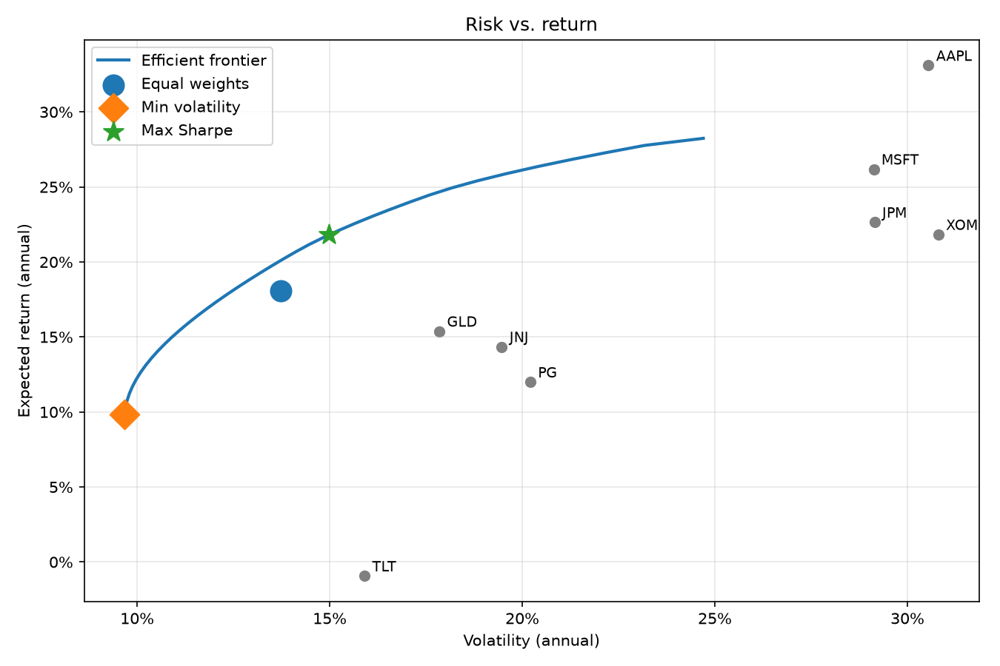
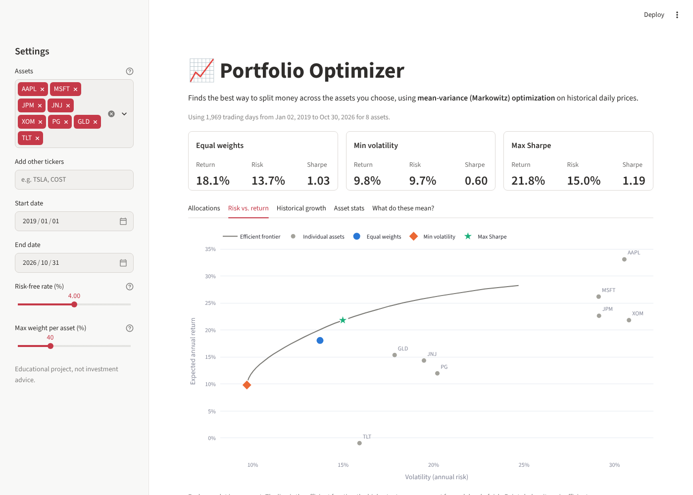

# Portfolio Optimizer

**Live dashboard: https://live-portfolio-optimizer.streamlit.app/**

A Python tool that finds the best way to split money across a set of stocks and funds, using **mean-variance (Markowitz) optimization**. It downloads real market data, stores it in a SQL database, measures each asset's return and risk, and solves a constrained optimization problem to find the lowest-risk and best risk-adjusted portfolios.



## Interactive dashboard

`app.py` is a Streamlit dashboard, [deployed on Streamlit Community Cloud](https://live-portfolio-optimizer.streamlit.app/): pick any assets (or type your own tickers), a date range, a risk-free rate and a per-asset limit, and it shows:

- the **optimal allocations** for the equal-weight, minimum-volatility and maximum-Sharpe portfolios
- a **risk vs. return chart** with the efficient frontier and every asset
- how $1 would have grown in each portfolio, plus per-asset stats and a correlation table



## Results

Analyzed 8 assets (Apple, Microsoft, JPMorgan, Johnson & Johnson, Exxon, Procter & Gamble, gold, and long-term US bonds) using daily prices from 2019 to 2026.

| Portfolio | Expected annual return | Annual volatility (risk) |
|---|---|---|
| Equal weights (baseline) | 18.1% | 13.7% |
| Minimum volatility | 9.8% | 9.7% |
| Maximum Sharpe ratio | 21.8% | 15.0% |

Key findings:

- **Diversification works.** The minimum-volatility portfolio is less risky than every individual asset, including bonds. Combining assets that don't move together cancels out much of their individual risk.
- **Equal weights is not efficient.** It sits below the efficient frontier: for the same level of risk, an optimized portfolio offers a higher expected return.
- **Gold and bonds play different roles.** The max Sharpe portfolio holds about 40% gold, because gold had decent returns and moved independently of stocks. Long-term bonds (TLT) lost value as interest rates rose after 2021, so the optimizer only uses them to reduce risk, not to earn return.

> **Limitation:** these results are *in-sample*: the portfolios were chosen using the same data they are evaluated on, so they look better than they would in real life. `backtest.py` tests the method on data the optimizer never saw.

## How it works

1. **Data** (`data.py`): downloads daily prices from Yahoo Finance, saves them to a SQLite database, and reads them back with SQL queries.
2. **Analysis** (`analysis.py`): converts prices into daily returns and computes annualized returns, volatility, and the covariance matrix (how assets move together).
3. **Optimization** (`optimizer.py`): uses SciPy to solve for the portfolio weights.
   - **Decision variables:** the share of money in each asset
   - **Objective:** minimize volatility, or maximize the Sharpe ratio (return per unit of risk)
   - **Constraints:** weights sum to 100%, no short selling, and at most 40% in any single asset
4. **Output** (`main.py`): prints the results, saves the weights to `outputs/weights.csv`, and plots the efficient frontier.
5. **Dashboard** (`app.py`): runs the same pipeline interactively in the browser with Streamlit and Plotly. Prices already in the database are read with SQL; anything missing is downloaded and saved first.

## Run it yourself

```bash
git clone https://github.com/Vicki810/portfolio-optimizer.git
cd portfolio-optimizer
python3 -m venv .venv
source .venv/bin/activate
pip install -r requirements.txt
python main.py           # command-line results and charts
streamlit run app.py     # interactive dashboard in your browser
```

To try different stocks, dates, or limits, edit `config.py`.

## Tech stack

Python · pandas · NumPy · SciPy · SQLite · Matplotlib · Plotly · Streamlit · yfinance

## Next steps

- ~~Backtest: choose weights on 2019–2023 data and test them on 2024–2026~~ (done: `backtest.py`)
- ~~Interactive Streamlit dashboard~~ (done: `app.py`)
- ~~Deploy the dashboard publicly on Streamlit Community Cloud~~ (done: [live link](https://live-portfolio-optimizer.streamlit.app/))

*This is an educational project, not investment advice.*
